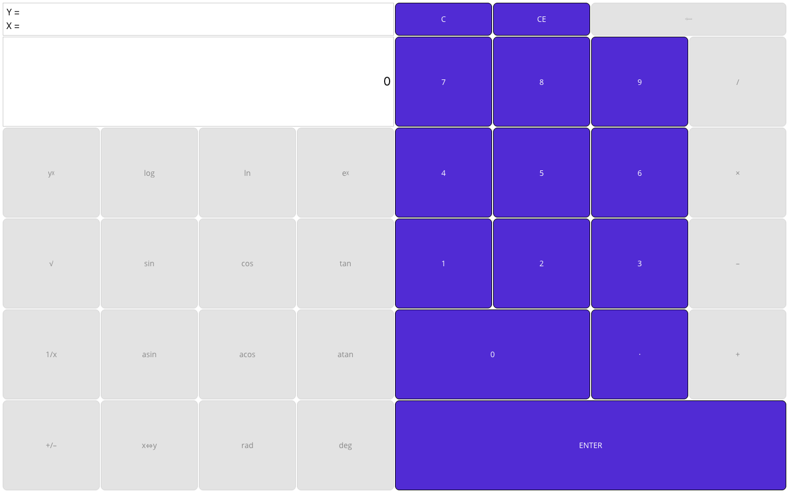
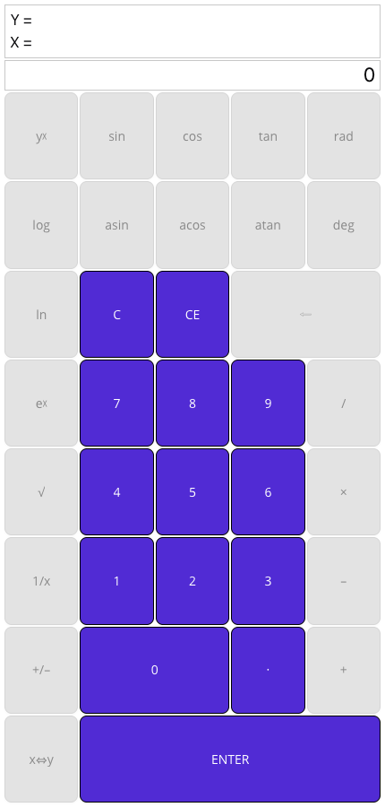

# RPN Calculator, running in the browser with MauiWeb

[RPN Calculator](https://github.com/dotnet/maui-samples/tree/main/10.0/Apps/RpnCalculator) is the .NET MAUI RPN (reverse Polish notation) calculator sample from Microsoft (MIT): a scientific RPN calculator with an X/Y stack.
This repository is the same app, moved to **.NET 11 / .NET MAUI 11.0.0**, with one extra project that serves it
as a website through [MauiWeb](https://mauiweb.appmare.com). The pages, XAML and C# are the original ones: the
browser gets real HTML rendered on the server, and every tap runs the app's own code.

**Try it live:** https://live.mauiweb.appmare.com/rpncalc (also in the [MauiWeb live gallery](https://mauiweb.appmare.com/gallery.html)'s Samples section).

| Desktop width | Phone width |
| --- | --- |
|  |  |

## Run it

Requirements: the .NET 11 SDK and the .NET MAUI 11 workload (`dotnet workload install maui`).

```bash
dotnet run --project src/RpnCalculator.Web
```

Open <http://localhost:5329>. MauiWeb is free on localhost, `.local`, `.test` and private hosts; a public
domain needs a licence (see the [pricing](https://mauiweb.appmare.com)).

The phone and desktop heads are still there: `src/RpnCalculator` targets `net11.0-android`, `net11.0-ios` and
`net11.0-maccatalyst` (and Windows on Windows) as before.

## What changed from the original

1. **`Directory.Build.props`** — `MauiVersion` 11.0.0, `DotNetVersion` 11.0.0.
2. **`src/RpnCalculator/RpnCalculator.csproj`** — targets moved from `net10.0-*` to `net11.0-*` and a plain `net11.0` target added (built as a library, so the web host can reference it).
3. **`src/RpnCalculator/MauiProgram.cs`** — `CreateMauiApp` takes an optional `Action<MauiAppBuilder>` so a host can add
   its own setup. The phone heads call it with no argument, as before.
4. **`src/RpnCalculator.Web/`** (new) — an empty ASP.NET Core project with the `AppMare.MauiWeb` package and one line in
   `Program.cs`:

   ```csharp
   app.MapMauiWeb(() => MauiProgram.CreateMauiApp(b => b.UseMauiWeb()));
   ```

   plus an item group that copies the app's `Resources/` (fonts, images) next to the web host.

## Licence

The sample is MIT, © Microsoft (see [LICENSE](LICENSE)); the original readme is kept as
[README.upstream.md](README.upstream.md) when there was one. The web host project added here is MIT too.
MauiWeb itself is a commercial package by [AppMare](https://appmare.com), free for local development.
